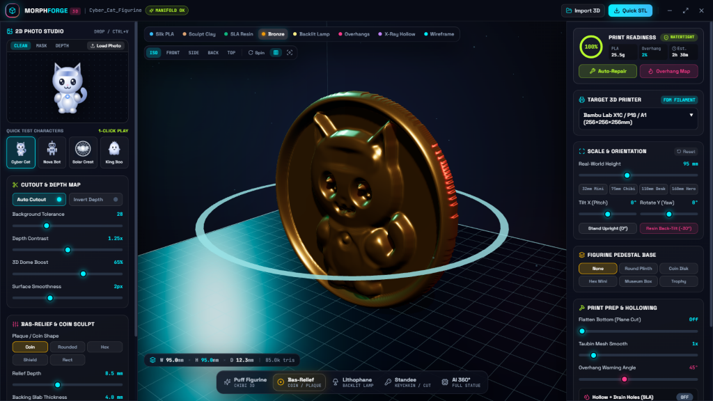
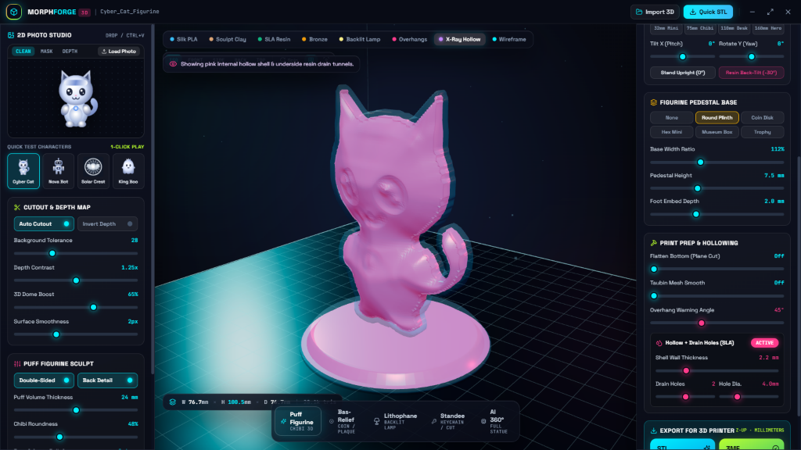

# MorphForge 3D

**Interactive Portable 2D-to-3D Studio for 3D Printing (FDM & SLA Resin)**

Turn any 2D photo, illustration, or character into a **100% watertight, slicer-ready 3D printable model** inside a motion-graphics desktop studio.

[](https://github.com/farid5301/morphforge-3d/releases/latest)
[](LICENSE)

---

## Preview

| Metallic Bas-Relief & Laser Scan Sweep | Resin X-Ray Hollowing + Drain Holes |
| :---: | :---: |
|  |  |

---

## Features

### 5 Interactive 2D-to-3D Modes
1. **Puff Figurine (Instant Offline Chibi 3D):** Exact 2D Euclidean Distance Transform + clamped silhouette contour relaxation + surface relief sculpting — produces **100% watertight, manifold** double-sided 3D character figurines.
2. **Bas-Relief / Coin / Medallion (Instant Offline):** Sculpted depth plaques with Circle Coin, Hexagon, Shield, Rounded, or Rectangular frames and raised beveled rims.
3. **Lithophane (Instant Offline Backlit Photo Lamp):** Physically mapped flat or self-standing curved lithophanes (`0.6mm–4.6mm`) with a live **Backlit Lamp** shader preview in the 3D viewport.
4. **Standee & Keychain (Instant Offline):** Crisp beveled silhouette extrusion with optional auto-placed keychain ring hole.
5. **AI 360° Full Statue (Pluggable Engine):** Connects directly from the Electron main process (zero CORS limits) to:
   - Free **Hugging Face Spaces** (`tencent/Hunyuan3D-2`, `JeffreyXiang/TRELLIS`, `stabilityai/TripoSR`, or any custom Space ID)
   - **Tripo3D** & **Meshy** Official APIs
   - **Local NVIDIA RTX GPU Bridge** ([`local-ai-bridge/server.py`](local-ai-bridge/server.py)) for offline CUDA 360° reconstruction on 8GB+ GPUs

### Built-in 3D Print Prep Studio (FDM & SLA Resin)
- **Virtual Printer Build Plates:** Bambu Lab X1C / P1S / A1 / A1 Mini, Prusa MK4S, Creality Ender 3 / K1, Elegoo Saturn 4 Ultra / Mars 5 Ultra, and Anycubic Photon Mono M7 with out-of-bounds alerts.
- **Live Print Readiness Ring:** Real-time manifold/watertight check, exact bounding dimensions (mm), volume (`cm³`), estimated filament weight (`g`), resin volume (`ml`), and print time estimate.
- **Overhang Heatmap Inspector:** Real-time color-coded angle warning shader (Safe / Caution / Needs Supports) with adjustable angle threshold.
- **Watertight Pedestal Generator:** 5 display bases (`Round Plinth`, `Coin Disk`, `Hex Mini`, `Museum Box`, `Stepped Trophy`) with configurable width, height, and foot embed depth.
- **Mesh Prep Tools:** One-click Auto-Repair, Flatten Bottom (Plane Cut), shrinkage-free Taubin Smoothing, Resin Back-Tilt (`-30°`), and **SLA Hollowing + Underside Drain Holes** with live **X-Ray Hollow** inspection.
- **Import Existing 3D Models:** Drag & drop `.GLB`, `.OBJ`, or `.STL` files straight into the Print Prep Studio (or paste 2D photos with `Ctrl+V`).

### Slicer-Ready Multi-Format Exports (Z-Up · Real Millimeters)
- **`.STL`** (Binary — universal compatibility with Bambu Studio, PrusaSlicer, OrcaSlicer, Cura, Chitubox, Lychee)
- **`.3MF`** (Spec-compliant compressed 3D Manufacturing Format package with millimeter units & metadata)
- **`.OBJ`** & **`.GLB`** (For further sculpting in Blender / ZBrush)

---

## Quick Start (Portable App)

1. Go to the [**Latest Release**](https://github.com/farid5301/morphforge-3d/releases/latest) and download **`MorphForge3D-Portable.exe`**.
2. Double-click to run — no installation required.

---

## Build from Source

```bash
npm install
npm run build
npm run pack:portable
```

### Optional: Local NVIDIA GPU 360° Bridge
```bash
cd local-ai-bridge
python -m venv .venv
.venv\Scripts\activate
pip install -r requirements.txt
python server.py
```
Then select **Local RTX GPU Bridge** under the **AI 360°** mode in MorphForge 3D.
